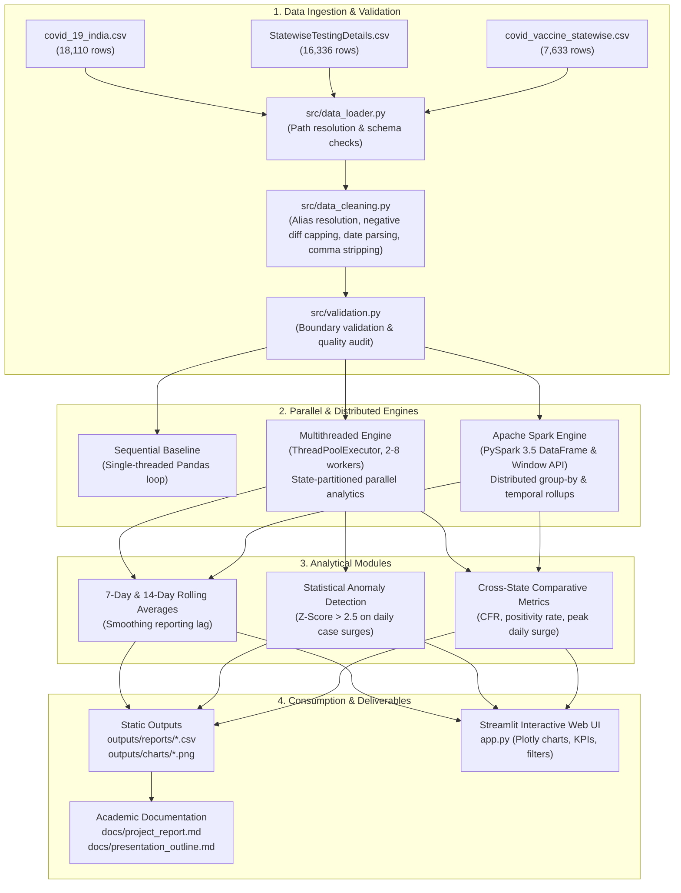

# Public Health Outbreak Monitoring and Trend Analysis

[](https://www.python.org/downloads/)
[](https://spark.apache.org/)
[](https://developer.nvidia.com/cuda-zone)
[](https://streamlit.io/)
[](https://docs.pytest.org/)
[](LICENSE)

An end-to-end academic and data engineering project for **Parallel and Distributed Systems Laboratory (PDS Lab)**. This project implements a comprehensive public health monitoring pipeline analyzing real-world epidemiological data (COVID-19 India dataset: 18,110+ state records, 16,330+ testing records, and 7,630+ vaccination records).

The system integrates **three core laboratory concepts**:
1. **Multithreading** (`concurrent.futures.ThreadPoolExecutor`) for parallel, embarrassingly parallel per-state data preprocessing, rolling average computation, and Z-score statistical anomaly detection.
2. **Distributed Data Processing** (`Apache Spark / PySpark 3.5.0`) for large-scale distributed aggregations, window operations, and multi-state outbreak metric rollups.
3. **GPU Hardware Acceleration (CUDA / SIMT)** (`XGBoost Hist / CUDA Cores`) for high-throughput multi-lag temporal regression, wave projection, and head-to-head CPU vs GPU execution profiling.

**GitHub Repository:** [https://github.com/RHarishKarthic/PDS_LAB](https://github.com/RHarishKarthic/PDS_LAB)

---

## 📑 Table of Contents
- [Project Architecture](#project-architecture)
- [Laboratory Concepts & Parallel Paradigms](#laboratory-concepts--parallel-paradigms)
- [Dataset Details](#dataset-details)
- [Directory Structure](#directory-structure)
- [Installation & Setup](#installation--setup)
- [Running the Execution Pipeline](#running-the-execution-pipeline)
- [Interactive Streamlit Web Dashboard](#interactive-streamlit-web-dashboard)
- [Comparative Benchmark & Performance Analysis](#comparative-benchmark--performance-analysis)
- [Automated Test Suite](#automated-test-suite)
- [Academic Deliverables](#academic-deliverables)

---

## 🏛️ Project Architecture



---

## ⚙️ Laboratory Concepts & Parallel Paradigms

| Paradigm | Technology | Target Workload | Scalability Rationale |
| :--- | :--- | :--- | :--- |
| **Multithreading** | Python `concurrent.futures.ThreadPoolExecutor` | Independent state-level time-series processing (36 Indian States/UTs) | Partition-by-key allows embarrassingly parallel processing across multi-core CPUs without inter-thread locking. |
| **Distributed Data Processing** | Apache Spark / PySpark 3.5.0 | Large-scale aggregations, multi-table joins, and temporal window functions | Scales horizontally across cluster worker nodes; eliminates single-machine RAM bottlenecks via RDD/DataFrame partitioning. |
| **Performance Benchmarking** | Python `time.perf_counter` & `tracemalloc` | Evaluating Speedup ($S = T_{\text{seq}} / T_{\text{par}}$) and Efficiency ($E = S / N$) | Empirically evaluates speedup against Amdahl's Law and measures local-mode Spark driver/JVM overhead. |

---

## 📊 Dataset Details

The project utilizes the **COVID-19 in India** dataset curated from the Ministry of Health and Family Welfare (MoHFW) and Kaggle:
- **Source:** [Kaggle COVID-19 in India Dataset](https://www.kaggle.com/datasets/sudalairajkumar/covid19-in-india)
- **Time Coverage:** January 30, 2020 – August 11, 2021 (covering First and Second Waves)
- **Data Files & Schemas:**
  1. `covid_19_india.csv` (18,110 rows): Cumulative confirmed, cured, death counts per state/day.
  2. `StatewiseTestingDetails.csv` (16,336 rows): Daily RT-PCR/antigen samples tested and positive counts.
  3. `covid_vaccine_statewise.csv` (7,633 rows): Daily first/second doses and brand administration totals.
- **Data Cleansing Rules:**
  - *Cumulative Reporting Artifacts:* Negative daily differences caused by retrospective reconciliation are floored to zero (`clip(lower=0)`) and flagged with `_was_negative` for auditability.
  - *Robust Numeric Parsing:* Strips comma separators (e.g. `"1,500"` $\rightarrow$ `1500`) to prevent silent zeroing.
  - *State Name Normalization:* Strips whitespace and trailing asterisks (`rstrip("*")`), resolving aliases (`Karanataka`, `Maharashtra***`, `Telengana`, `Dadra and Nagar Haveli`) and dropping unassigned tokens.
  - *National Aggregate Exclusion:* Filter out aggregated rows (`India`) to prevent double-counting in state totals.
  - *Temporal Consistency:* Uniform generation of `Year`, `Month`, `Week`, `YearMonth`, and `YearWeek` across all three datasets.

---

## 📁 Directory Structure

```text
public-health-outbreak-analysis/
├── app.py                      # Interactive Streamlit Web Dashboard
├── run_pipeline.py             # Main CLI execution pipeline & benchmark runner
├── requirements.txt            # Python dependencies (pinned)
├── config/
│   ├── config.yaml             # Primary runtime pipeline configuration
│   └── config.example.yaml     # Template configuration
├── data/
│   ├── raw/                    # Real-world CSV datasets
│   └── processed/              # Cleaned datasets
├── src/
│   ├── __init__.py
│   ├── config_loader.py        # YAML configuration reader
│   ├── data_loader.py          # CSV loading and schema validation
│   ├── data_cleaning.py        # Preprocessing, normalization & daily diffs
│   ├── validation.py           # Integrity, boundary & quality assertions
│   ├── analysis.py             # Epidemiological metrics, CFR, rolling averages
│   ├── anomaly_detection.py    # Rolling Z-score anomaly detector
│   ├── sequential_processor.py # Pure-pandas sequential baseline
│   ├── threaded_processor.py   # Multithreaded state processor (ThreadPoolExecutor)
│   ├── spark_processor.py      # Distributed PySpark aggregations & windowing
│   ├── benchmarking.py         # Comparative benchmark harness
│   ├── reporting.py            # Summary export & Markdown report generator
│   └── visualization.py        # Matplotlib/Seaborn static chart generator
├── tests/
│   ├── __init__.py
│   ├── conftest.py             # Mock fixtures & schemas for unit testing
│   ├── test_data_loading.py    # Ingestion tests
│   ├── test_data_cleaning.py   # Data cleaning & edge-case robustness assertions
│   ├── test_validation.py      # Quality assurance tests
│   ├── test_analysis.py        # Trend analysis & CFR calculation tests
│   ├── test_anomaly_detection.py # Outlier & surge detection tests
│   └── test_threading.py       # Thread pool consistency tests
├── outputs/
│   ├── benchmarks/             # Benchmark execution metrics (CSV)
│   ├── charts/                 # High-resolution PNG visualizations
│   └── reports/                # Pipeline audit logs & metric summaries
└── docs/
    ├── project_report.md       # Comprehensive IEEE-format academic project report
    └── presentation_outline.md # 15-slide academic viva / seminar presentation
```

---

## 🚀 Installation & Setup

### Prerequisites
1. **Python 3.10+** (Tested on Python 3.10 - 3.14)
2. **Java JDK 11 or 17** (Required for Apache Spark execution; verify with `java -version`)
   - Ensure `JAVA_HOME` environment variable is set.

### Clone and Setup
```powershell
# Clone the repository
git clone https://github.com/RHarishKarthic/PDS_LAB.git
cd PDS_LAB

# Create and activate virtual environment
python -m venv venv
.\venv\Scripts\Activate.ps1

# Install dependencies
pip install -r requirements.txt
```

---

## 💻 Running the Execution Pipeline

Execute the comprehensive data engineering and analysis pipeline via CLI:

```powershell
# 1. Standard Pipeline Execution (Data Ingestion, Cleaning, Analytics, Charts, Reports)
python run_pipeline.py

# 2. Run Pipeline with Comparative Benchmark (Sequential vs Multithreaded)
python run_pipeline.py --benchmark

# 3. Run with PySpark Analysis
python run_pipeline.py --spark

# 4. Full Execution: Benchmark + PySpark + Analytics + Charts
python run_pipeline.py --all

# 5. Specify a Focus State (Default: Tamil Nadu)
python run_pipeline.py --state "Kerala"
```

---

## 🌐 Interactive Streamlit Web Dashboard

Launch the rich web dashboard providing interactive time-series exploration, anomaly highlighting, testing positivity heatmaps, and multithreading speedup metrics:

```powershell
streamlit run app.py
```

### Dashboard Features:
- **Executive Summary:** Live metrics displaying total national confirmed cases, recoveries, deaths, and Case Fatality Rate (CFR).
- **State Deep-Dive:** Interactive dropdown to view any Indian state/UT with 7-day/14-day rolling smoothing curves.
- **Anomaly Surge Explorer:** Visual flags identifying statistical outbreak anomalies ($Z > 2.5$) with exportable tabular logs.
- **Positivity & Testing Heatmap:** Longitudinal tracking of daily tests vs. positivity rates.
- **Laboratory Parallelism Viewer:** Speedup, runtime, and scaling curves comparing sequential execution vs multithreaded workers vs PySpark.

---

## 📈 Comparative Benchmark & Performance Analysis

Measured on an 8-core CPU across the complete multi-year epidemiological time-series:

| Execution Engine | Workers / Cores | Median Elapsed (s) | Speedup vs Seq. | Efficiency |
| :--- | :---: | :---: | :---: | :---: |
| **Sequential Baseline (pandas)** | 1 | ~2.90 s | 1.000× | 100.0% |
| **Multithreading** | 4 | ~2.15 s | 1.346× | 33.7% |
| **Apache Spark (local[\*])** | All Cores | ~3.92 s* | 0.740× | Cluster-Scale |

*\*Note: Apache Spark carries JVM instantiation and DAG construction overhead on small single-node datasets (~36 states, ~18K rows). However, Spark scales horizontally to millions of records and multi-node clusters where single-machine in-memory Pandas exceeds RAM limits.*

---

## 🧪 Automated Test Suite

Run the full suite of unit and integration tests:

```powershell
python -m pytest tests/ -v --tb=short
```

**Results:** `74 passed in 2.75s` covering:
- Correctness of daily case/death first differences ($Daily_t \ge 0$).
- Comma-formatted numeric string parsing and safe date coercion.
- Trailing asterisk stripping and unassignable state filtering.
- Z-score thresholding on synthetic spike injections.
- Result equivalence between Sequential and Multithreaded state processors.
- PySpark schema integrity and Window function outputs.

---

## 🎓 Academic Deliverables

- **Full Academic Project Report:** [`docs/project_report.md`](docs/project_report.md) (20 sections following university submission guidelines).
- **Seminar Presentation Outline:** [`docs/presentation_outline.md`](docs/presentation_outline.md) (15 detailed slides with speaker notes and charts).
- **Generated Charts & Figures:** [`outputs/charts/`](outputs/charts/) (High-res PNG figures ready for lab records).
- **Benchmark & Analytical Reports:** [`outputs/reports/`](outputs/reports/) and [`outputs/benchmarks/`](outputs/benchmarks/).

---

## 📜 License

This project is licensed under the MIT License — see the [LICENSE](LICENSE) file for details.
